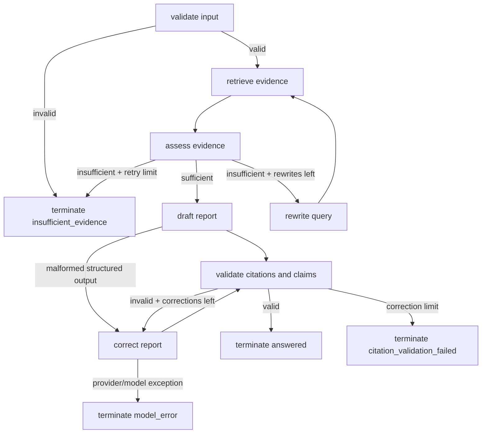

# Research Assistant (Self-RAG evolution)

This package provides a modular, testable research assistant built alongside the archival notebook at `examples/rag/langgraph_self_rag.ipynb`.

The original notebook is preserved unchanged (blob SHA `23751308ce25e9dfe0d1e6e7aa8f10e2e007605f`).

## Purpose

- Preserve the original notebook unchanged for historical reference.
- Provide a production-style example with explicit graph orchestration, bounded retries, citation validation, and deterministic offline tests.
- Keep provider integration as an adapter injection boundary so tests stay provider-independent.

## Graph architecture

The assistant orchestration uses an explicit LangGraph `StateGraph` with bounded looping and terminal statuses.



A defensive `max_graph_steps` limit hard-stops execution with `retry_limit_exceeded`.

## Terminal statuses

- `answered`
- `insufficient_evidence`
- `citation_validation_failed`
- `model_error`
- `retry_limit_exceeded`

## Retry and attempt accounting

The run result tracks these counters separately:

- `retrieval_attempts`
- `query_rewrites`
- `generation_attempts`
- `correction_attempts`
- `total_graph_steps`

Terminal errors include explicit limit context, for example retrieval-attempt, correction-attempt, or graph-step limits.

## Citation validation semantics

Citation checks are deterministic and include:

1. Citation ID existence against retrieved evidence IDs.
2. Lexical claim-support checks against cited passages.
3. Punctuation/case/simple token normalization before overlap scoring.
4. Detailed issue output including claim ID, citation ID, reason, support score, and matched terms when available.

> Lexical support is a deterministic heuristic for testing and guardrails. It is not semantic entailment.

## Setup

```bash
cd examples/rag/research_assistant
make install
```

## Environment variables

- `RESEARCH_ASSISTANT_MAX_RETRIEVAL_ATTEMPTS`
- `RESEARCH_ASSISTANT_MAX_CORRECTION_ATTEMPTS`
- `RESEARCH_ASSISTANT_MAX_GRAPH_STEPS`
- `RESEARCH_ASSISTANT_MIN_EVIDENCE_CHUNKS`
- `RESEARCH_ASSISTANT_MAX_RETRIEVED_CHUNKS`

Credentials are never committed. Provider-backed adapters should read credentials from environment variables.

## Provider integration boundary

`examples/provider_openai_example.py` is intentionally a boundary example that prints integration guidance. It does not ship a working OpenAI adapter.

## Testing and quality checks

```bash
make format
make lint
make test
```

All included tests are deterministic and run offline without provider API keys.

## Deterministic evaluation fixture

A reproducible fixture is provided at `evaluation/deterministic_fixture.json`.

Run measured deterministic evaluation:

```bash
uv run python examples/compare_workflows.py
```

Reported deterministic metrics include:

- answer status
- citation validity
- supported-claim rate
- retrieval attempts
- correction attempts
- latency

Provider-backed outputs are illustrative and not included in these measured metrics.

## Limitations

- Claim support uses lexical overlap, not semantic entailment.
- Real provider integrations must be injected via retriever/generator protocols.

## Attribution

This project is inspired by the archival LangGraph Self-RAG notebook and the Self-RAG research direction. Upstream `langchain-ai/langgraph` core libraries are intentionally left unchanged.
